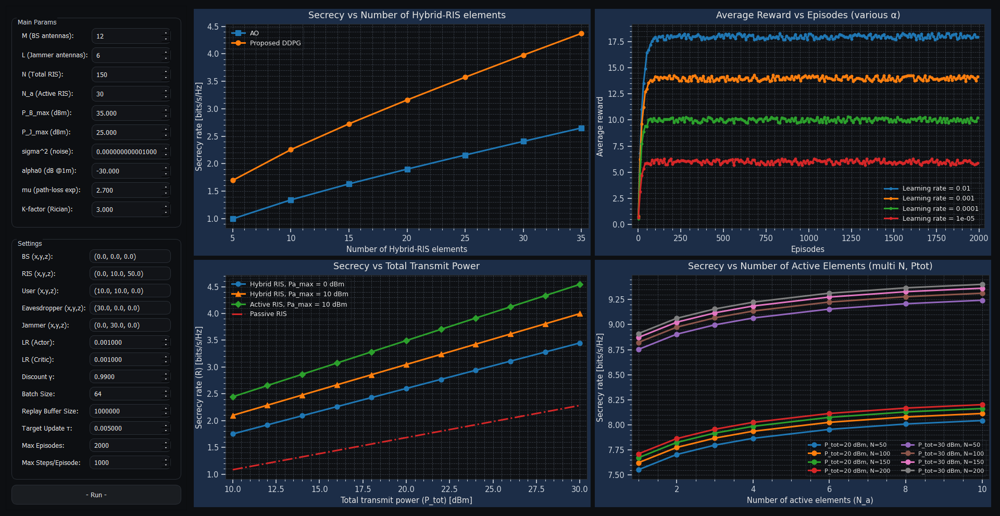

<h1 align="center">Hybrid RIS - DRL Visualizer</h1>

<p align="center"><b>Interactive GUI for a hybrid active-passive RIS system with a DRL approach</b></p>

<p align="center">
  
  
  
  [](https://github.com/alisadhk/hybrid-ris-gui/releases/latest)
</p>

---

## Overview
A PyQt5 + Matplotlib desktop application to configure and visualize a hybrid active-passive reconfigurable intelligent surface (RIS) scenario against eavesdropping and jamming, driven by a deep reinforcement learning (DRL) approach. It uses a dark theme and shows tooltips on the plots without changing them.

## Features
- Dark mode UI with default Matplotlib colors
- Parameter panels (Main Params, Settings) on the left, plots on the right
- Position inputs in (x, y, z) form
- Run button that regenerates all plots
- Non-intrusive Qt tooltips over the plots

## Screenshots
<p align="center"></p>

## Download and install
### Option A - Download
No prebuilt binary is published for this project. Use Option B below.

### Option B - Run from source
Requirements: Windows 10/11 and Python 3.10+.

```bash
git clone https://github.com/alisadhk/hybrid-ris-gui.git
cd hybrid-ris-gui
python -m pip install -r requirements.txt
python hybrid_ris_black.py
```

## How to use
1. Start the application with `python hybrid_ris_black.py`.
2. Set the main parameters and the node positions (x, y, z) in the left panel.
3. Adjust the extra values in the **Settings** tab.
4. Press **- Run -** and inspect the plots on the right; hover the plot to read values.

## Configuration and privacy
- No credentials are used by this project.

## Build the executable yourself
```bash
python -m pip install pyinstaller
python -m PyInstaller --noconfirm 
```
The executable is created in the `dist/` folder.

## Notes
- The related research paper is not included for copyright reasons.

---

<p align="center">Maintained by <a href="https://github.com/alisadhk">@alisadhk</a> - last update 2025-09-08</p>